# Minecraft 旅游系统

> 一站式智慧旅游服务平台，为用户提供景点推荐、酒店预订、票务预订、美食推荐、特产商城、出行计划、社区交流等全方位旅游服务。

## 项目简介

Minecraft 旅游系统是一个基于 Spring Boot 3 + Vue 3 构建的综合性旅游服务平台，采用前后端分离架构。项目包含 **Web 用户端**、**管理端**、**移动端（uni-app）** 与 **后端服务** 四大部分，并内置推荐系统、即时通讯、跟团游、3D 地球可视化等特色能力。

## 项目组成

| 子项目 | 说明 | 技术栈 | 开发端口 |
|--------|------|--------|----------|
| `Minecraft/` | 后端服务 | Spring Boot 3 + MyBatis Plus | 8080 |
| `minecraft-ui/` | 用户端 Web | Vue 3 + Element Plus + Vite | 8090 |
| `minecraft-admin-main/` | 管理端（新版） | Vue Vben Admin 5.7 + antdv-next + Tailwind CSS v4 | 5999 |
| `minecraft-admin/` | 管理端（旧版，保留） | Vue 3 + Element Plus + ECharts + Vite | 8070 |
| `minecraft-App/` | 移动端 | uni-app 3.0（HBuilderX） | - |

## 技术栈

### 后端技术（Minecraft）

| 技术 | 版本 | 说明 |
|------|------|------|
| Java | 17 | 开发语言 |
| Spring Boot | 3.0.2 | 基础框架 |
| Spring Security | - | 安全框架 |
| MyBatis Plus | 3.5.3.2 | ORM 框架 |
| Spring Data JPA | - | 数据访问（辅助） |
| Druid | 1.2.24 | 数据库连接池 / SQL 监控 |
| MySQL | 8.0 | 关系型数据库 |
| Redis | Lettuce | 缓存/会话存储 |
| WebSocket | - | 实时通信（IM、音视频信令） |
| JWT (jjwt) | 0.12.5 | 身份认证 |
| Aliyun OSS | 3.15.1 | 对象存储 |
| TIANAI-CAPTCHA | 1.5.5 | 滑块验证码 |
| Spring Mail | - | 邮件服务 |
| SpringDoc + Knife4j | 2.0.2 | API 文档 |
| Hutool / FastJSON / Lombok | - | 工具库 |

### 用户端技术（minecraft-ui）

| 技术 | 版本 | 说明 |
|------|------|------|
| Vue | 3.5.25 | 前端框架 |
| Vite | 7.3.1 | 构建工具 |
| Element Plus | 2.13.2 | UI 组件库 |
| Vue Router | 4.6.4 | 路由管理 |
| Pinia | 3.0.4 | 状态管理（含持久化插件） |
| Axios | 1.13.5 | HTTP 客户端 |
| vue-i18n | 11.x | 国际化 |
| globe.gl + three.js | 2.46 / 0.186 | 3D 地球可视化 |
| 高德地图 JS API | 2.0 | 地图与导航 |

### 管理端技术（minecraft-admin-main）

| 技术 | 版本 | 说明 |
|------|------|------|
| Vue Vben Admin | 5.7.0 | Monorepo 脚手架（Turborepo + pnpm） |
| Vue | 3.x | 前端框架 |
| antdv-next | catalog | UI 组件库（主应用 `apps/web-antdv-next`） |
| Tailwind CSS | v4 | 原子化样式 |
| Pinia / Vue Router | 3.x / 4.x | 状态与路由 |
| @tanstack/vue-query | - | 服务端状态管理 |
| TypeScript | 5.x | 类型系统 |

### 移动端技术（minecraft-App）

| 技术 | 版本 | 说明 |
|------|------|------|
| uni-app | 3.0 | 跨端框架（App/H5/小程序） |
| Pinia | - | 状态管理 |
| HBuilderX | - | 开发工具 |

## 核心功能

### 用户端功能（minecraft-ui）

| 模块 | 功能 |
|------|------|
| 用户认证 | 注册、登录（账号/手机/二维码/滑块验证码）、找回密码、个人信息管理 |
| 首页 | 轮播图、首页推荐位、月份推荐、网站介绍 |
| 景点推荐 | 景点列表、景点详情、按城市/季节筛选、评分点赞评论 |
| 酒店预订 | 酒店列表、酒店详情、房型/设施、预订下单 |
| 票务预订 | 火车票/机票/出租车票查询预订 |
| 美食推荐 | 美食列表、美食详情、按菜系筛选、评分点赞评论 |
| 特产商城 | 商品浏览、购物车、订单管理、支付 |
| 出行计划 | 创建/编辑/删除出行计划、AI 行程推荐 |
| 跟团游/攻略 | 发起/加入团队、行程计划、帖子、投票、账单分摊、相册、游记 |
| 社区交流 | 发布帖子、浏览社区、点赞收藏评论 |
| 环球旅行 | 大洲/国家/城市浏览、世界特色、每月推荐 |
| 地图导航 | 3D 地球（globe.gl）+ 高德地图搜索/路线/收藏/天气 |
| 即时通讯 | 好友互动、单聊/群聊、音视频通话、表情管理 |
| 其他 | 公告中心、积分商城（兑换）、个人中心、多语言（i18n）、主题切换 |

### 管理端功能（minecraft-admin-main）

| 模块 | 功能 |
|------|------|
| 工作台/分析 | 数据看板、访问分析、趋势图表 |
| 内容管理 | 公告、票务、积分商城、卡片、安全提示、网站介绍等 |
| 旅行管理 | 景点/酒店/美食/商品/新闻/轮播/社区、大洲/国家/城市、跟团游及子模块（计划/帖子/投票/通知/位置/账单/相册/日记）、订单/支付/评论/点赞/收藏/聊天/购物车等 |
| 推荐管理 | 推荐看板、推荐规则、干预规则、推荐项、参数配置、调度任务 |
| 用户管理 | 用户列表、认证记录、订单、登录信息、Token、AI 行程 |
| 服务管理 | 在线用户、缓存管理、操作日志、服务监控 |
| 系统管理 | 系统日志、登录日志、Swagger UI、OpenAPI JSON |

## 数据库设计

- 数据库名：`db_minecraft`（MySQL 8.0，utf-8）
- 实体规模：100+ 张表 / 实体类
- SQL 脚本位置：`Minecraft/src/main/resources/static/sql/`
  - `db_minecraft.sql` — 全量建表及初始数据
  - `announcement.sql` — 公告模块增量脚本

### 核心表结构（节选）

| 表名 | 说明 |
|------|------|
| user | 用户表 |
| attraction / hotel / food / product / ticket | 景点 / 酒店 / 美食 / 商品 / 票务 |
| attraction_ticket / hotel_room | 景点门票 / 酒店房型 |
| hotel_booking / ticket_booking | 酒店预订 / 票务预订 |
| orders / payment / cart | 订单 / 支付 / 购物车 |
| comment / like / collection | 评论 / 点赞 / 收藏 |
| community_post | 社区帖子 |
| chat_message / chat_group / friend | 聊天消息 / 群聊 / 好友 |
| travel_plan | 出行计划 |
| group_travel / group_member / group_bill ... | 跟团游及其子表（计划/帖子/投票/相册/账单等） |
| announcement / announcement_read | 公告 / 公告已读 |
| points_record / points_products / exchange_order | 积分体系 |
| recommendation_*（config/item/rule 等） | 推荐系统 |
| officialwebsite_* | 官网内容配置 |
| carousels / carousel_groups | 轮播图 |
| login_log / operation_log / system_log | 日志体系 |
| continents / countries / cities | 大洲 / 国家 / 城市 |
| file_info | 文件信息表 |

## 项目结构

```
Minecraft-system/
├── Minecraft/                    # 后端项目 (Spring Boot 3)
│   ├── src/main/java/com/minecraft/
│   │   ├── controller/           # 控制器层 (73个控制器)
│   │   ├── service/              # 服务层
│   │   ├── mapper/               # 数据访问层
│   │   ├── entity/               # 实体类 (100+)
│   │   ├── dto/                  # 数据传输对象
│   │   ├── vo/                   # 视图对象
│   │   ├── config/               # 配置类
│   │   ├── interceptor/          # 拦截器
│   │   ├── aspect/               # 切面
│   │   ├── utils/                # 工具类
│   │   ├── enums/                # 枚举类
│   │   ├── exception/            # 异常处理
│   │   └── MinecraftApplication.java
│   ├── src/main/resources/
│   │   ├── mapper/               # MyBatis映射文件
│   │   ├── static/sql/           # SQL脚本
│   │   └── application.yml       # 配置文件
│   └── pom.xml
├── minecraft-ui/                 # 用户端前端 (Vue 3 + Element Plus)
│   ├── src/
│   │   ├── views/                # 页面组件 (景点/酒店/美食/商城/社区/地图/IM等)
│   │   ├── components/           # 公共组件
│   │   ├── router/               # 路由配置
│   │   ├── store/                # Pinia状态管理
│   │   └── api/                  # API接口
│   └── package.json
├── minecraft-admin-main/         # 管理端 (Vue Vben Admin 5.7 monorepo)
│   ├── apps/
│   │   └── web-antdv-next/       # 管理端主应用
│   │       └── src/views/        # dashboard/content/travel/recommendation/user/service/system
│   ├── packages/                 # @vben 内部包
│   └── package.json
├── minecraft-admin/              # 旧版管理端 (Element Plus，保留)
├── minecraft-App/                # 移动端 (uni-app)
│   ├── pages/                    # 页面 (首页/景点/酒店/美食/票务/商城/社区/IM等)
│   ├── api/                      # API接口
│   ├── stores/                   # Pinia状态管理
│   └── pages.json
└── README.md
```

## 快速开始

### 环境要求

- JDK 17+
- Maven 3.6+
- MySQL 8.0+
- Redis 6.0+
- Node.js 20+（用户端/旧管理端）
- Node.js ^22.18 或 ^24.12、pnpm ≥ 11（新管理端 minecraft-admin-main）
- HBuilderX（移动端，可选）

### 数据库初始化

```bash
# 进入SQL目录
cd Minecraft/src/main/resources/static/sql

# 执行建表脚本
mysql -u root -p < db_minecraft.sql

# 公告模块（可选增量）
mysql -u root -p < announcement.sql
```

### 后端启动

```bash
# 进入后端项目
cd Minecraft

# 修改配置文件
# 编辑 src/main/resources/application.yml，配置数据库和Redis连接信息

# 启动项目
mvn spring-boot:run

# 或使用IDE运行 com.minecraft.MinecraftApplication
```

后端服务启动后访问：`http://localhost:8080`

### 用户端启动（minecraft-ui）

```bash
cd minecraft-ui

# 安装依赖
npm install

# 启动开发服务器
npm run dev
```

用户端启动后访问：`http://localhost:8090`（已配置 `/api`、`/ws` 代理到 `localhost:8080`）

### 管理端启动（minecraft-admin-main，推荐）

```bash
cd minecraft-admin-main

# 安装依赖（仅支持 pnpm）
pnpm install

# 启动主应用
pnpm dev:antdv-next
```

管理端启动后访问：`http://localhost:5999`（接口地址 `http://localhost:8080/api`）

### 旧版管理端启动（minecraft-admin，可选）

```bash
cd minecraft-admin

npm install
npm run dev
```

旧版管理端启动后访问：`http://localhost:8070`

### 移动端启动（minecraft-App）

使用 HBuilderX 打开 `minecraft-App` 目录，运行到浏览器、手机或模拟器即可；也可使用 uni-app CLI 执行 `npm run dev` / `npm run build`。

## 配置说明

### 数据库配置（application.yml）

```yaml
spring:
  datasource:
    type: com.alibaba.druid.pool.DruidDataSource
    url: jdbc:mysql://localhost:3306/db_minecraft?useUnicode=true&characterEncoding=utf-8&useSSL=false&serverTimezone=Asia/Shanghai&allowPublicKeyRetrieval=true
    username: root
    password: your_password
```

Druid 监控页面：`http://localhost:8080/druid/`（账号密码见 `stat-view-servlet` 配置）

### Redis配置

```yaml
spring:
  data:
    redis:
      host: localhost
      port: 6379
      password:
```

### JWT配置

```yaml
jwt:
  secret: your-secret-key
  expiration: 604800000  # 7天
```

### 文件上传配置

```yaml
file:
  upload-path: ./uploads
  allowed-types: jpg,jpeg,png,gif,bmp,mp3,mp4,wav,amr,pdf,doc,docx,xls,xlsx,ppt,pptx,zip,rar
  max-size: 104857600  # 100MB

image:
  upload:
    windows-dir: D:/Image/
    unix-dir: /tmp/images/
```

## 接口文档

项目集成了 SpringDoc + Knife4j，启动后端服务后访问：

- API文档：`http://localhost:8080/doc.html`
- OpenAPI JSON：`http://localhost:8080/v3/api-docs`

## 安全机制

- **JWT认证**：Token-based身份认证
- **Spring Security**：权限控制与安全防护
- **滑块验证码**：TIANAI-CAPTCHA 人机校验
- **密码加密**：BCrypt加密存储
- **请求拦截**：Token拦截器验证
- **SQL防火墙**：Druid wall filter 防注入

## 部署说明

### 后端打包

```bash
cd Minecraft
mvn clean package
java -jar target/Minecraft-0.0.1-SNAPSHOT.jar
```

### 前端打包

```bash
# 用户端
cd minecraft-ui
npm run build

# 管理端（新版）
cd minecraft-admin-main
pnpm build:antdv-next

# 管理端（旧版）
cd minecraft-admin
npm run build
```

### Nginx配置示例

```nginx
server {
    listen 80;
    server_name your-domain.com;

    # 用户端
    location / {
        root /path/to/minecraft-ui/dist;
        try_files $uri $uri/ /index.html;
    }

    # 管理端
    location /admin {
        root /path/to/minecraft-admin-main/apps/web-antdv-next/dist;
        try_files $uri $uri/ /admin/index.html;
    }

    # 后端API代理
    location /api {
        proxy_pass http://localhost:8080;
        proxy_set_header Host $host;
        proxy_set_header X-Real-IP $remote_addr;
    }
}
```

## 贡献指南

欢迎提交 Issue 和 Pull Request 来帮助完善项目。

## 许可证

本项目采用 MIT 许可证。

## 联系方式

- 项目地址：https://github.com/HH-han/Minecraft-system
- 问题反馈：请提交 Issue

---

**Minecraft 旅游系统 - 让旅行更简单、更美好**

## 运行截图

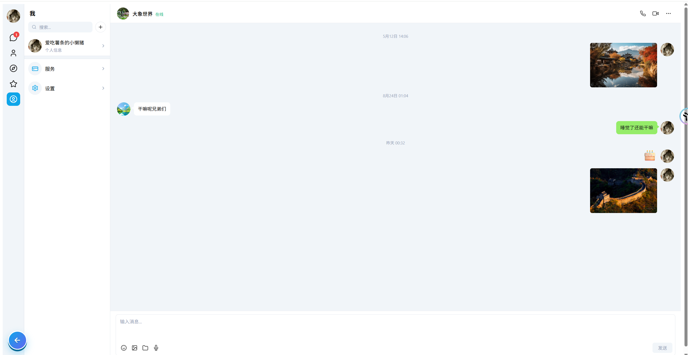

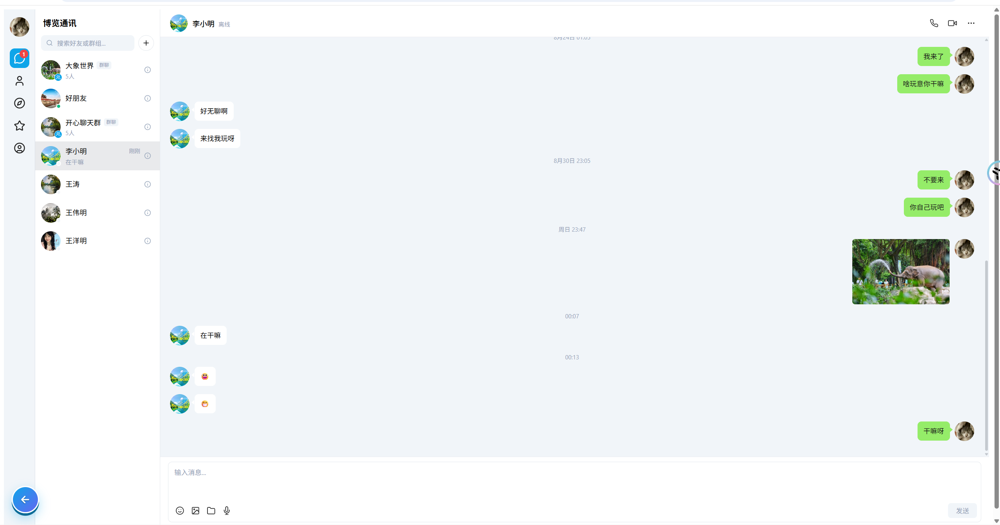

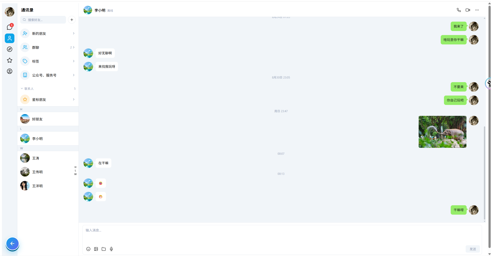

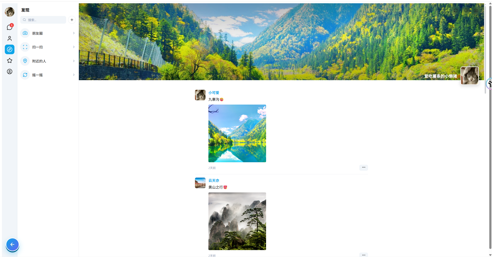

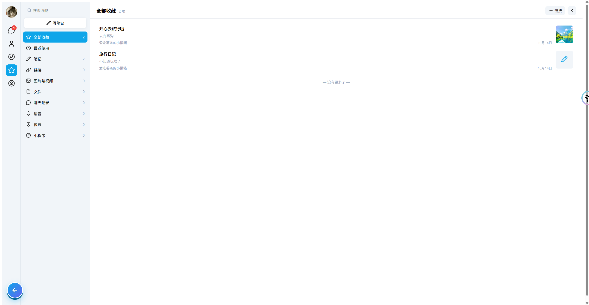

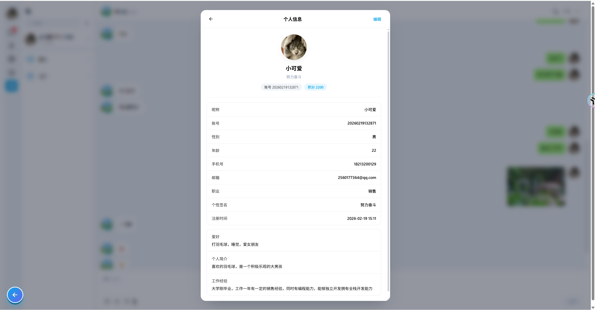

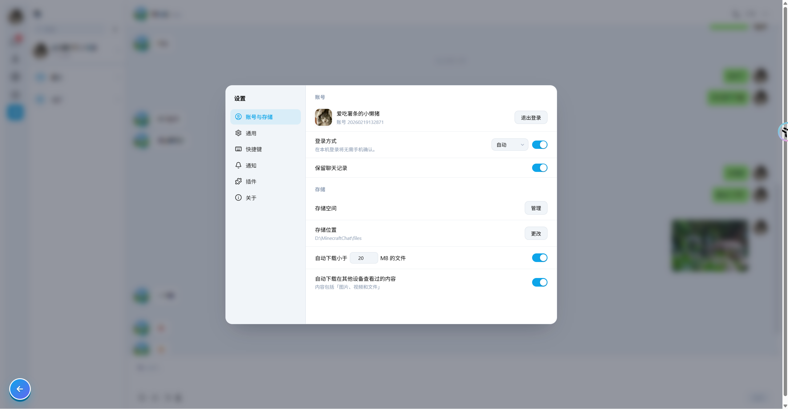

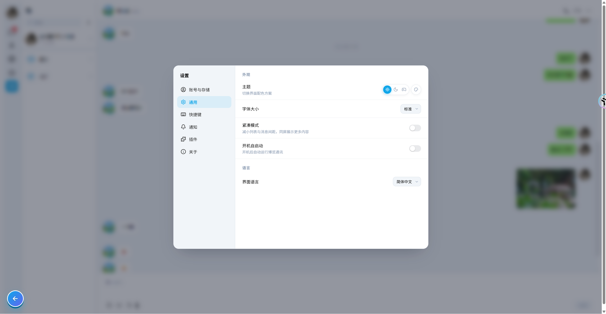

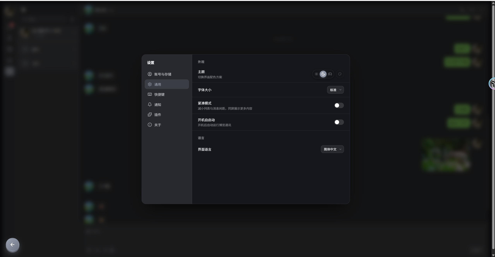

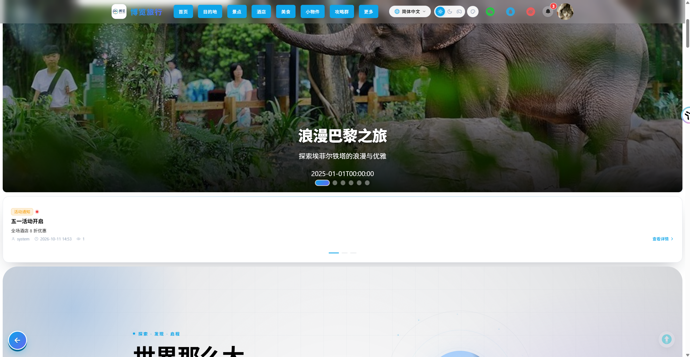

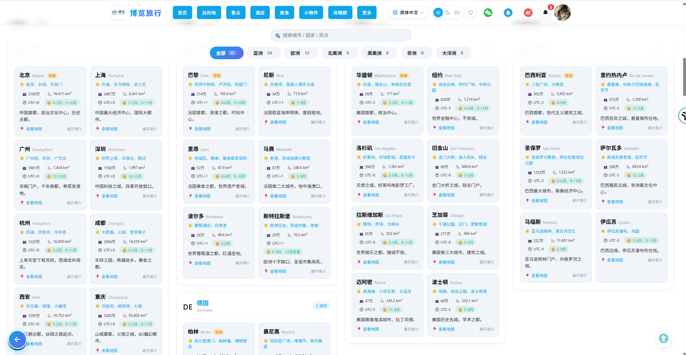

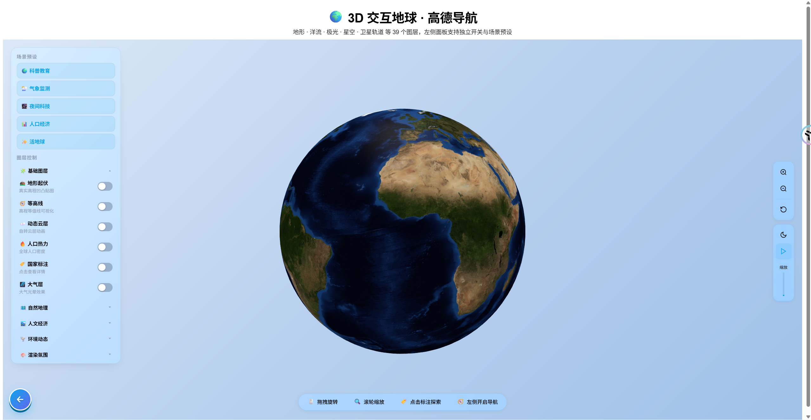

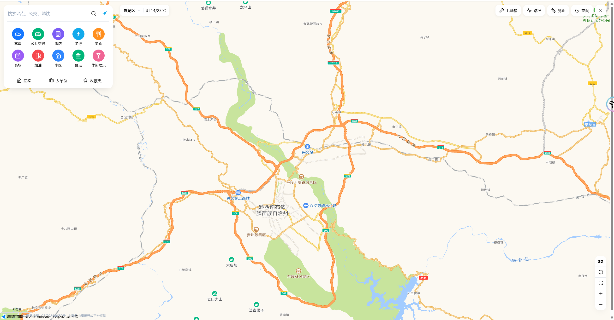

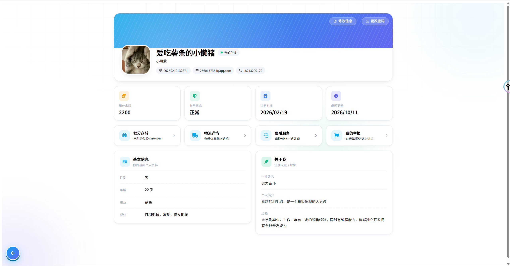


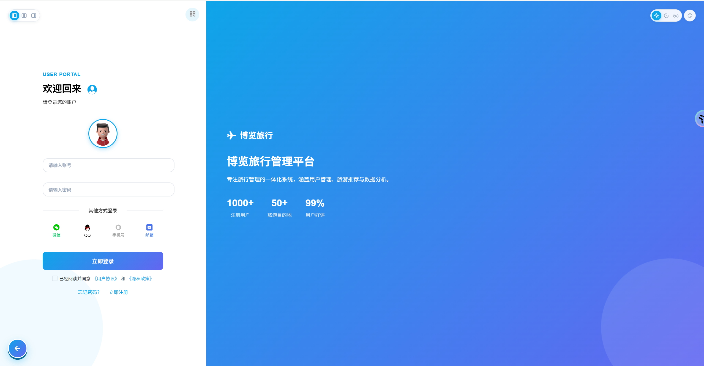

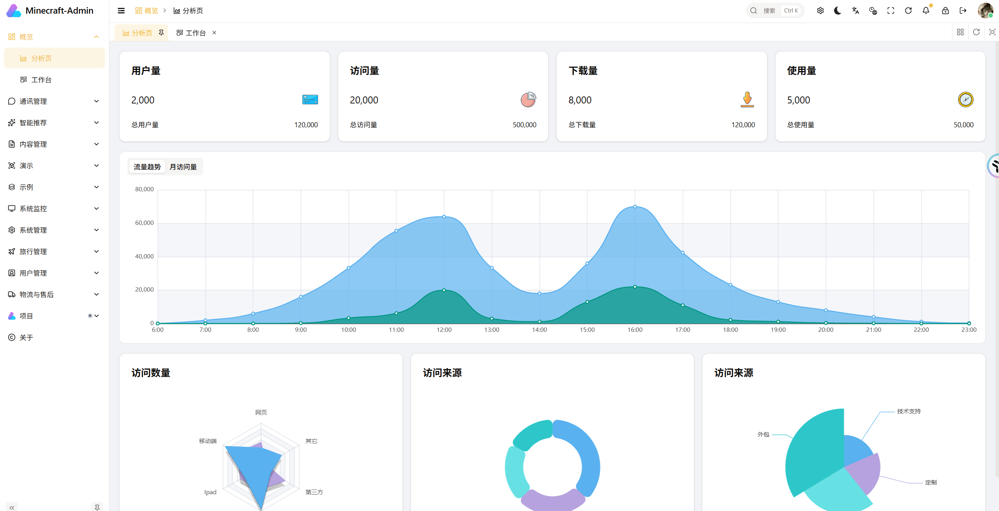

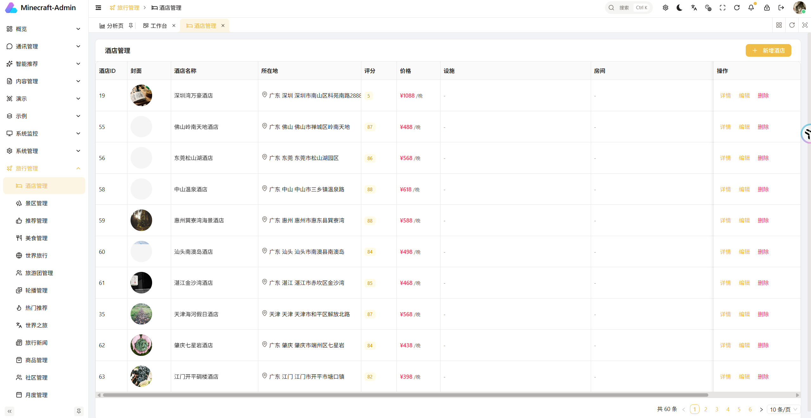

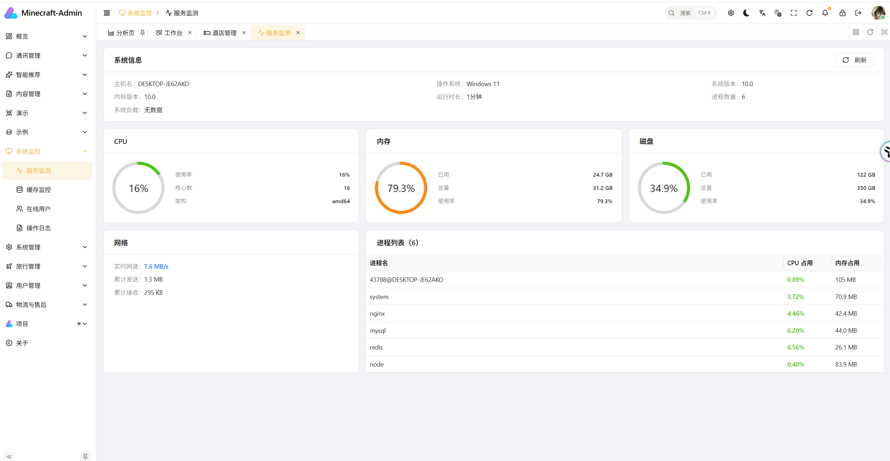

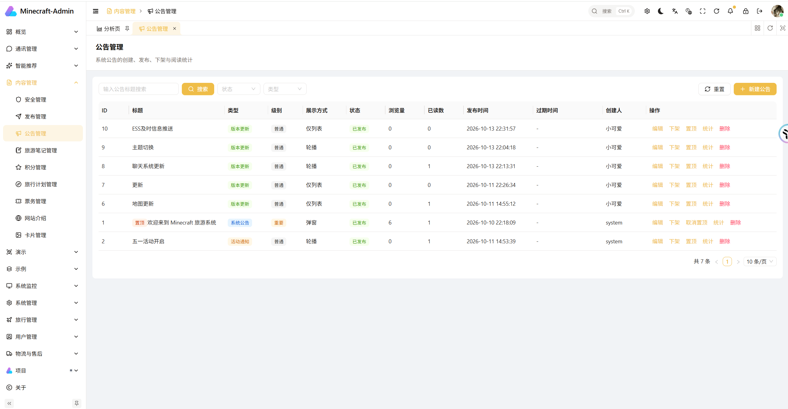
